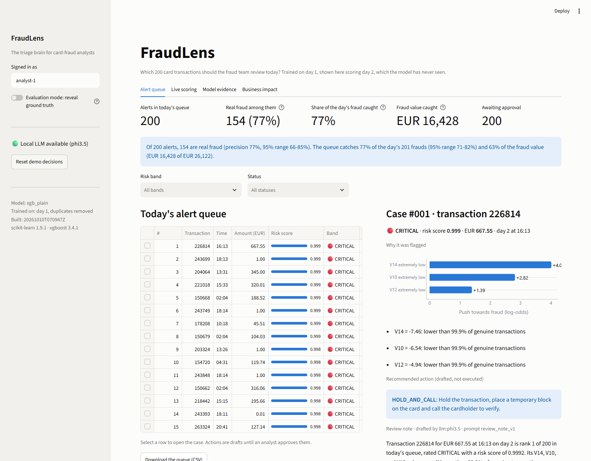
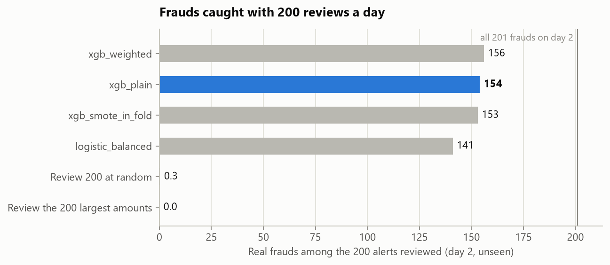
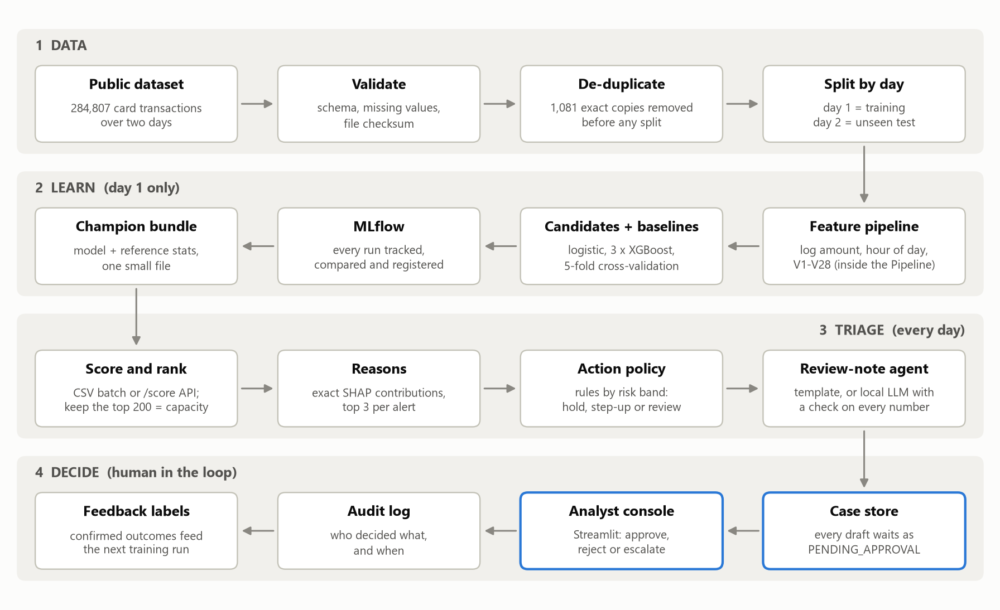

# FraudLens

**The triage brain for card-fraud analysts: which 200 transactions should the team review today?**

A card issuer's fraud team can review 200 alerts a day out of roughly 140,000 transactions. FraudLens scores every transaction, hands the team the 200 riskiest with the reasons, a recommended action and a drafted review note, and waits for a human to approve.

On a day the model had never seen, **154 of its 200 alerts were real fraud**. Reviewing the 200 largest transactions that day would have caught none.

| On the unseen day (day 2) | Result |
|---|---|
| Real fraud among the 200 alerts | **154** (precision 77%, 95% range 66-85%) |
| Share of the day's 201 frauds caught | **77%** (95% range 71-82%) |
| Fraud value caught | EUR 16,428 of EUR 26,122 (63%) |
| Same 200 reviews spent on the largest amounts | 0 frauds |
| Same 200 reviews chosen at random | 0.3 frauds |



**Live app:** add the Streamlit Community Cloud link here after deploying (steps under [Setup](#setup-and-installation-instructions)).
**Solution document:** [docs/FraudLens_Solution_Document.docx](docs/FraudLens_Solution_Document.docx) · **Pitch deck:** [docs/FraudLens_Pitch.pptx](docs/FraudLens_Pitch.pptx) · **Alert queue artefact:** [outputs/alert_queue_top200.csv](outputs/alert_queue_top200.csv)

---

## Problem Statement

The client is a card issuer processing about 300,000 transactions in two days. Fraud is rare (0.17% of transactions), but each miss costs money and customer trust, and each false alarm annoys a customer and uses analyst time. The review team can handle **200 alerts per day**.

The ask: *"Build the triage brain: which transactions should our fraud analysts review first?"*

**The decision being improved** is how those 200 daily reviews are spent. **The success measure** is business, not statistical: how many real frauds, and how much fraud value, the team catches with the capacity it already has.

Three things make this harder than it looks:

1. **Accuracy lies.** A system that answers "never fraud" is 99.83% accurate and catches nothing.
2. **The data sets traps.** The file contains 1,081 exact duplicate rows, and the usual fix for rare classes (oversampling) silently leaks test data into training if it is applied in the wrong place.
3. **Capacity is a hard limit.** Day 1 holds 272 frauds, so even a perfect model could catch at most 74% of them with 200 reviews.

## Solution Overview

FraudLens turns a day of transactions into a ranked, explained, actionable queue.

1. **Score.** A gradient-boosted model (XGBoost), trained on day 1 only, gives each transaction a fraud-risk score.
2. **Rank to capacity.** The 200 highest scores become the day's alert queue. The cutoff is the team's capacity, not an arbitrary probability.
3. **Explain.** Each alert carries its top three reasons, computed as exact SHAP contributions and phrased against what genuine transactions look like ("V14 = -7.46: lower than 99.9% of genuine transactions").
4. **Recommend.** A rule-based policy maps the risk band to an action: hold and call, step-up verification, or analyst review.
5. **Draft.** A review-note agent writes the note for each alert. A deterministic template is the default; a local open-source LLM (phi3.5 through Ollama) can rewrite it as a short narrative. An LLM draft is used only if every number in it appears in the evidence.
6. **Wait for a human.** Every action is `PENDING_APPROVAL`. An analyst approves, rejects or escalates in the console, and each decision is written to an audit log.

### What the data showed, and what we did about it

| Finding (see [notebooks/01_eda.ipynb](notebooks/01_eda.ipynb)) | Handling |
|---|---|
| 492 frauds in 284,807 transactions (0.17%) | Accuracy is never used. Headline metrics are PR-AUC and precision/recall at 200 alerts |
| 1,081 exact duplicate rows, 19 of them fraud. A random split puts 403 copies in both train and test | Duplicates are removed before any split |
| Two days of data; `Time` is a running counter | Train on day 1, test on day 2. Raw `Time` is replaced by hour of day |
| 36% of frauds are EUR 1.00 or less (11% of genuine payments) | "Largest amounts first" is a baseline to beat; micro-amounts get a card-testing reason and advice |
| Fraud rate at 2am is 1.45%, nine times the average | Hour of day is a model input and a plain-language reason |
| Oversampling before the split inflates PR-AUC to 0.9999 | SMOTE runs only inside the training fold. The wrong way is run once, on purpose, to measure the lie (honest score: 0.760) |

### Model results

Models were chosen by 5-fold cross-validation on day 1. Day 2 was scored once, at the end.

| Model | Imbalance handling | CV PR-AUC (day 1) | PR-AUC (day 2) | ROC-AUC (day 2) | Frauds in top 200 |
|---|---|---|---|---|---|
| Review 200 at random | not a model | | 0.001 | | 0.3 |
| Review the 200 largest amounts | not a model | | 0.002 | | 0 |
| Logistic regression (baseline) | class weights | 0.702 ± 0.055 | 0.735 | 0.942 | 141 |
| **XGBoost, plain (champion)** | none, ranking only | **0.877 ± 0.012** | 0.769 | 0.981 | **154** |
| XGBoost, weighted | `scale_pos_weight` | 0.868 ± 0.018 | 0.792 | 0.979 | 156 |
| XGBoost + SMOTE in fold | SMOTE inside training folds | 0.849 ± 0.030 | 0.774 | 0.965 | 153 |

The weighted model caught two more frauds on day 2. We kept the plain model because the rule was set in advance (best cross-validated PR-AUC on day 1), and switching after seeing the test day would be choosing on the test set. The three XGBoost variants are within noise of each other; the step from logistic regression to boosting is the real gain.

ROC-AUC is 0.94 to 0.98 for every model, which is why it is not the headline: it barely separates a baseline from the champion. On the textbook random 75/25 split the champion scores PR-AUC 0.831; the day-ahead replay (0.769) is the harder and more honest number.



## Architecture Diagram



Design decisions behind the picture (more in [docs/ARCHITECTURE.md](docs/ARCHITECTURE.md)):

- **One pipeline object.** Feature engineering, scaling, resampling and the model are steps of a single scikit-learn Pipeline, so nothing can be fitted on data it should not see.
- **Capacity is a parameter.** The queue is "the top *k*", with *k* = 200 in one config line. The capacity planner in the app replays the day at any *k*.
- **The agent proposes, a person disposes.** Scoring, explaining and drafting are automated. Executing an action is not: it needs an approval, and the approval is logged.
- **The LLM is optional and fenced.** It only rephrases facts it is handed, a check rejects any draft containing a number that is not in those facts, and the template takes over if the model is absent. The prompt is versioned in [prompts/](prompts/).
- **Small, portable artefacts.** The app needs a 0.3 MB model bundle and 4 MB of sample data, so it runs offline on a laptop and on the free tier of Streamlit Community Cloud.

## Technology Stack

Everything is free and open source. No paid service, no API key, no secret in the repo.

| Layer | Technology | Why |
|---|---|---|
| Language | Python 3.12 | |
| Data | pandas, NumPy, PyArrow | The dataset fits in memory on a laptop |
| Modelling | scikit-learn, XGBoost, imbalanced-learn | Pipelines that prevent leakage; SMOTE confined to training folds |
| Explanations | XGBoost built-in SHAP values | Exact contributions with no extra dependency |
| Experiment tracking | MLflow (SQLite backend) | Every run logged, compared and the champion registered |
| GenAI | Ollama + phi3.5 (local) | Review-note drafting with no data leaving the machine |
| App | Streamlit, Plotly | Analyst console, live scoring, capacity planner |
| API | FastAPI | `/score` endpoint for integration into a payment flow |
| Case store | SQLite | Approval workflow and audit log |
| Quality | pytest (20 tests), ruff | Leakage guards, artefact consistency, agent guardrails |

## Setup and Installation Instructions

Requires Python 3.11 or newer (developed on 3.12).

### Run the app (2 minutes, no data download)

The trained model and a day-2 sample are in the repo.

```bash
git clone https://github.com/mjbharathgithub/Fraud-Lens.git
cd Fraud-Lens
python -m venv .venv
.venv\Scripts\activate            # macOS/Linux: source .venv/bin/activate
pip install -r requirements.txt
streamlit run streamlit_app.py
```

Open http://localhost:8501. Add `?tab=live` to the address to land on live scoring.

### Rebuild everything from the raw data (about 5 minutes)

```bash
pip install -r requirements-dev.txt
python -m fraudlens all           # download, train, build the queue, render figures
pytest                            # 20 tests
mlflow ui --backend-store-uri sqlite:///mlflow.db    # run comparison at http://localhost:5000
```

`python -m fraudlens all` downloads the public dataset (150 MB, checksum-verified, no login) into `data/raw/`.

### Optional: LLM-drafted review notes

Install [Ollama](https://ollama.com), then:

```bash
ollama pull phi3.5
python -m fraudlens queue --llm 25     # the local LLM drafts the top 25 notes
```

Without Ollama everything still works: notes come from the deterministic template.

### Optional: scoring API

```bash
uvicorn fraudlens.api:app --port 8000      # interactive docs at http://localhost:8000/docs
```

### Deploy to Streamlit Community Cloud (free)

1. Sign in at [share.streamlit.io](https://share.streamlit.io) with GitHub and choose **Create app**.
2. Repository `mjbharathgithub/Fraud-Lens`, branch `main`, main file `streamlit_app.py`.
3. Under **Advanced settings**, choose Python 3.12, then **Deploy**.

The hosted app has no local LLM, so it shows the template notes and the LLM drafts generated ahead of time.

## Business Benefits

- **The same team catches far more fraud.** With no extra headcount, 200 reviews go from finding almost nothing (0 by largest amount, 0.3 at random) to finding 154 real frauds on the test day, worth EUR 16,428 that day.
- **Analyst time goes where it pays.** About three in four alerts are real. The 62 alerts in the CRITICAL band were 97% fraud; the 93 in HIGH, 81%; the 45 in ELEVATED, 42%. The band tells the analyst how much scrutiny an alert needs.
- **Faster, more consistent decisions.** Each alert arrives with its reasons, an action and a drafted note, so the analyst verifies and approves instead of starting from a blank page.
- **Fewer good customers interrupted.** Calls and card blocks are reserved for the alerts most likely to be fraud.
- **A staffing answer, not just a score.** On the test day, going from 200 to 300 reviews finds only 5 more frauds (154 to 159). At this model's quality the team is already near the knee of the curve: the next gain comes from better signals, not more reviewers.
- **Safe to adopt.** Nothing executes without a human approval, every decision is logged, and the method is honest about its limits (a 95% range on every headline number).

One finding worth the client's attention: 20 of the 46 false alarms are near-identical EUR 0.77 transactions spread through the day. One pattern produces almost half the wasted reviews, so ruling on it once (allow-list it, or confirm it as unreported fraud) would free about 10% of the daily capacity.

## Future Enhancements

1. **Close the feedback loop.** Analyst decisions are already stored as labels; retrain on them on a schedule and track precision by band over time.
2. **Monitor drift.** Two days cannot show weekly patterns or changing fraud tactics. Add input-drift checks and a weekly precision-at-200 report before trusting the model for long.
3. **Group look-alike alerts.** Let an analyst rule once on a repeating pattern such as the EUR 0.77 cluster.
4. **Card-level features.** The public data hides card identity. With it, velocity features (transactions per card per hour, first use at a merchant) usually add the most signal.
5. **Rank by expected loss.** Combine risk with amount and the card's remaining limit so the queue maximises money protected, not only frauds found.
6. **Real-time path.** The `/score` endpoint already returns a decision in tens of milliseconds; put it behind the authorisation flow with a streaming threshold recalibrated daily.
7. **Calibrated probabilities and a model card review** before any regulated use.

---

## Repository layout

```
fraudlens/            the package
  data.py             download, validate, de-duplicate, split
  features.py         feature engineering as a Pipeline step
  models.py           baseline and candidate model definitions
  train.py            cross-validation, MLflow tracking, champion selection, artefacts
  metrics.py          PR-AUC, precision/recall at capacity, bootstrap ranges, capacity curve
  explain.py          per-alert reasons from SHAP contributions
  triage.py           scoring, ranking, risk bands, action policy, alert queue
  agent.py            review-note drafting: template, local LLM, grounding check
  store.py            case store and audit log (SQLite)
  api.py              FastAPI scoring service
streamlit_app.py      analyst console
notebooks/01_eda.ipynb   exploratory analysis, executed, with findings
prompts/              versioned LLM prompt
models/               champion model bundle
outputs/              alert queue (CSV and JSON), metrics, figures, run comparison
docs/                 solution document, pitch deck, architecture, judge Q&A, AI usage
tests/                20 tests
```

## Where each scoring item is evidenced

| Rubric item | Where to look |
|---|---|
| Business framing | [Problem Statement](#problem-statement), Business impact tab |
| EDA and traps | [notebooks/01_eda.ipynb](notebooks/01_eda.ipynb) |
| Baseline + stronger model, right metric, capacity-tied operating point, no leakage | [Model results](#model-results), [fraudlens/train.py](fraudlens/train.py), [tests/test_pipeline.py](tests/test_pipeline.py) |
| Actionable output | [outputs/alert_queue_top200.csv](outputs/alert_queue_top200.csv), [outputs/queue_statement.txt](outputs/queue_statement.txt) |
| Live scoring | Live scoring tab |
| MLflow run comparison | [outputs/run_comparison.csv](outputs/run_comparison.csv), [docs/screenshots/mlflow_compare.png](docs/screenshots/mlflow_compare.png) |
| Agent touch, `PENDING_APPROVAL` | [fraudlens/agent.py](fraudlens/agent.py), [fraudlens/store.py](fraudlens/store.py), Alert queue tab |
| Questions a judge may ask | [docs/JUDGE_QA.md](docs/JUDGE_QA.md) |
| Use of AI-assisted tools | [docs/AI_ASSISTED_DEVELOPMENT.md](docs/AI_ASSISTED_DEVELOPMENT.md) |

## Limits

- Two days of data from 2013. The numbers show the method works on an unseen day; they are not a forecast of production performance.
- The PCA behind V1-V28 was fitted by the data provider on the whole file, a mild upstream leak that cannot be undone from here.
- Hour of day assumes the dataset's clock starts near midnight, which the overnight dip in volume supports but does not prove.
- The cost figures in the capacity planner are assumptions for the client to replace.

## Data

[Credit Card Fraud Detection](https://www.kaggle.com/datasets/mlg-ulb/creditcardfraud), Machine Learning Group, Université Libre de Bruxelles, released under the Open Database License. The raw file is not stored in this repo; `python -m fraudlens download` fetches it. A small day-2 sample is included so the app can run.
