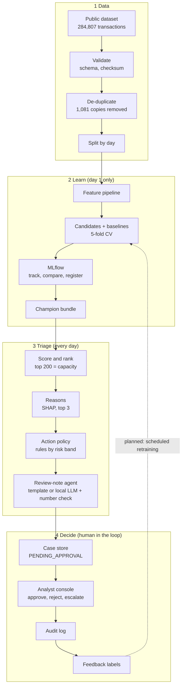

# Architecture

The same flow as an editable diagram:

## Components

| Stage | Module | Responsibility |
|---|---|---|
| Data | `fraudlens/data.py` | Download with checksum, schema check, duplicate removal, day split, stratified split |
| Learn | `fraudlens/features.py` | Stateless feature step: log amount, cyclical hour of day, V1-V28 passed through |
| Learn | `fraudlens/models.py` | Four candidate pipelines: logistic baseline and three XGBoost variants |
| Learn | `fraudlens/train.py` | Cross-validation on day 1, champion selection, one-time day-2 test, leakage exhibit, MLflow logging, artefacts |
| Learn | `fraudlens/metrics.py` | PR-AUC, precision/recall/value at *k*, bootstrap ranges, capacity curve, band profile |
| Triage | `fraudlens/triage.py` | Scoring, top-*k* queue, risk bands, action policy, one-line note, queue statement |
| Triage | `fraudlens/explain.py` | Per-alert SHAP contributions turned into plain-language reasons |
| Triage | `fraudlens/agent.py` | Evidence object, template note, local-LLM note, grounding check, draft cache |
| Decide | `fraudlens/store.py` | SQLite case store and audit log |
| Decide | `streamlit_app.py` | Analyst console: queue, live scoring, model evidence, capacity planner |
| Integrate | `fraudlens/api.py` | FastAPI `/score` and `/health` |

## Design decisions

**Evaluate the way the system will be used.** The client reviews 200 alerts *per day*, and the file holds two days. Training on day 1 and building the day-2 queue is a literal replay of production: no look-ahead, and the top 200 is a real daily queue. A random split mixes both days, is easier (PR-AUC 0.831 against 0.769), and its test set is only half a day.

**Choose the model before looking at the test day.** The selection rule (highest mean PR-AUC in 5-fold cross-validation on day 1) was fixed first. Day-2 results are reported for every candidate, but were not used to choose.

**Leakage is prevented by structure, not by care.** Every fitted step lives inside one Pipeline, and SMOTE sits in an imbalanced-learn Pipeline that applies it during `fit` only. Tests assert that the scaler's statistics come from training rows alone and that prediction adds no synthetic rows.

**Capacity defines the operating point.** There is no hand-picked probability threshold. The queue is the top *k* scores, and *k* is the team's capacity. For a real-time flow, the cutoff is the score of the last completed day's 200th alert.

**Risk bands are policy, reported with evidence.** CRITICAL (score ≥ 0.99) and HIGH (≥ 0.90) decide how strong the drafted action is. They are settings for the fraud-operations lead, and `outputs/metrics.json` reports how often each band was right: 97%, 81% and 42% on day 2.

**The agent is constrained on purpose.** It may gather evidence, choose an action from a fixed policy and draft text. It may not execute anything. The LLM sees only a JSON evidence object, is told to quote numbers exactly, and its draft is rejected if any number in it is not in the evidence, if it omits the transaction id, or if it claims fraud is confirmed. All 25 pre-generated drafts passed.

**Artefacts are the interface.** Training writes a model bundle, a metrics file and the queue. The app and the API only read them, so they start in seconds, run offline, and cannot disagree with the reported numbers. A test checks that the committed model reproduces the committed scores.

## Scaling notes

- **Volume.** Scoring 140,000 transactions takes well under a second on a laptop; the model is 0.3 MB. A million transactions a day needs no architectural change.
- **Real time.** `/score` is stateless and loads the bundle once, so it scales horizontally behind a load balancer.
- **Storage.** SQLite is right for a demo and a single team. A shared deployment would move the case store to PostgreSQL behind the same `store.py` functions.
- **Models.** MLflow's registry already versions the champion; promotion to production would add an approval step and a shadow period.
